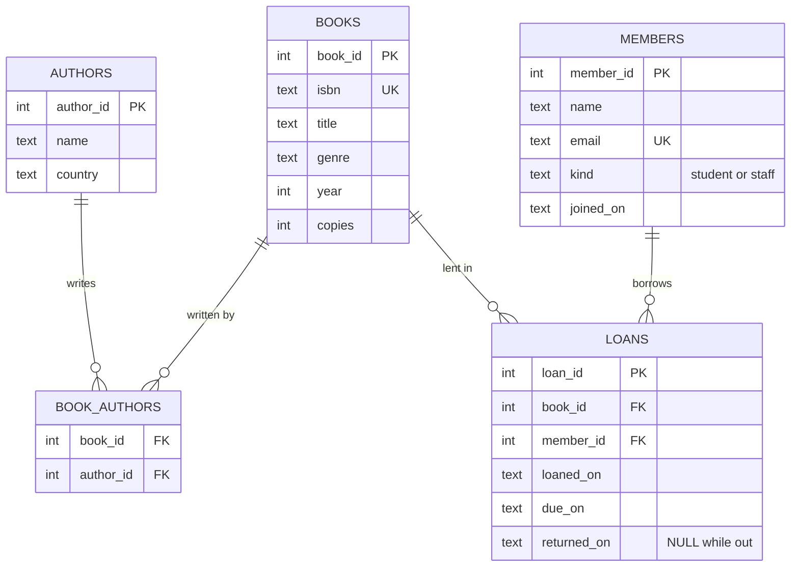

# 📚 Campus Library (SQL)

[](https://github.com/blackdalc7/campus-library-sql/actions/workflows/ci.yml)

A small library management database built with **SQLite**. It has a normalised schema with constraints, views and triggers, realistic seed data, a collection of example queries that goes from basic `SELECT`s to window functions, and a Python command line app on top.

I built this while learning SQL for a databases module. I wanted something more interesting than a single table, so it covers the usual library problems: many-to-many authors, loans, overdue fines, and rules like "students can only hold 3 books".

## The schema



Everything is in [`sql/schema.sql`](sql/schema.sql):

| Feature | What it does |
|---|---|
| **Foreign keys** | loans must point at real books and members; deleting a book that has loans is blocked |
| **`ON DELETE CASCADE`** | deleting an unborrowed book also removes its rows in `book_authors` |
| **`CHECK` constraints** | sensible years, no negative copies, valid emails, `kind IN ('student', 'staff')`, due date after loan date |
| **`UNIQUE`** | ISBN and email |
| **Indexes** | including a *partial index* on open loans only (`WHERE returned_on IS NULL`) |
| **View `book_availability`** | copies minus open loans |
| **View `fines`** | 0.25 per day late, capped at 10.00 |
| **Trigger `no_loan_without_copy`** | refuses a loan when no copies are on the shelf |
| **Trigger `loan_limit`** | students can hold 3 books, staff 10 |

Putting the rules in the database (not only in Python) means they hold no matter which program writes to it.

The seed data ([`sql/seed.sql`](sql/seed.sql)) has 25 real books and authors, plus 12 made-up members and 34 loans during 2026.

## Quick start

No dependencies, only the Python standard library.

```bash
git clone https://github.com/blackdalc7/campus-library-sql.git
cd campus-library-sql
export PYTHONPATH=src                 # Windows PowerShell: $env:PYTHONPATH="src"

python -m library search python
python -m library --today 2026-10-30 overdue
python -m library borrow 3 4          # book 3 to member 4
python -m library return 3 4
python -m library history 1
python -m library popular -n 3
python -m library stats
python -m library sql sql/queries/05_cte_and_windows.sql
```

The first command creates `library.db` and loads the seed data. Use `--db :memory:` for a throwaway database, and `--today YYYY-MM-DD` to pretend it's another day (handy for testing fines).

You can also use the database directly with the `sqlite3` shell:

```bash
sqlite3 library.db < sql/schema.sql
sqlite3 library.db < sql/seed.sql
sqlite3 -header -column library.db < sql/queries/03_aggregates.sql
```

### Example output

```
$ python -m library --today 2026-10-30 overdue
member           title                       due_on      days_late  fine
---------------  --------------------------  ----------  ---------  ----
Emma Schmidt     The C Programming Language  2026-10-06  24         6.00
Aisha Khan       Dune                        2026-10-22  8          2.00
Dr. Kofi Mensah  Modern Operating Systems    2026-10-23  7          1.75
Ben Carter       Introduction to Algorithms  2026-10-26  4          1.00

$ python -m library borrow 2 4
error: no copies available            <- the trigger said no
```

## The query collection

Each file in [`sql/queries/`](sql/queries) focuses on one topic, with a comment above every query explaining what it answers. `python -m library sql <file>` runs a file and prints each result as a table.

| File | Topics |
|---|---|
| [`01_basics.sql`](sql/queries/01_basics.sql) | `SELECT`, `WHERE`, `ORDER BY`, `LIMIT`, `LIKE`, `BETWEEN` |
| [`02_joins.sql`](sql/queries/02_joins.sql) | `INNER JOIN`, many-to-many with `GROUP_CONCAT`, `LEFT JOIN … IS NULL` to find books never borrowed |
| [`03_aggregates.sql`](sql/queries/03_aggregates.sql) | `COUNT`, `SUM`, `AVG`, `GROUP BY`, `HAVING`, date maths with `julianday` |
| [`04_subqueries.sql`](sql/queries/04_subqueries.sql) | `IN`, `EXISTS` / `NOT EXISTS`, scalar subqueries |
| [`05_cte_and_windows.sql`](sql/queries/05_cte_and_windows.sql) | `WITH` (CTEs), `RANK() OVER (PARTITION BY …)`, running totals, `LAG` |
| [`06_views_and_rules.sql`](sql/queries/06_views_and_rules.sql) | using the views, fines, and how the trigger blocks a loan |
| [`07_reports.sql`](sql/queries/07_reports.sql) | percentages, student vs staff habits, most-read authors |

A taste of `05_cte_and_windows.sql`:

```sql
-- Loans per month with a running total
WITH monthly AS (
    SELECT strftime('%Y-%m', loaned_on) AS month, COUNT(*) AS loans
    FROM loans GROUP BY month
)
SELECT month, loans, SUM(loans) OVER (ORDER BY month) AS running_total
FROM monthly
ORDER BY month;
```

```
month    loans  running_total
-------  -----  -------------
2026-01  2      2
2026-02  3      5
2026-03  4      9
...
2026-10  8      34
```

## Python app structure

```
src/library/
├── db.py     connect, create schema, seed, split .sql files into statements
├── repo.py   search, borrow, return_book, overdue, member_history, popular, stats
└── cli.py    argparse commands + a small text-table printer
sql/
├── schema.sql
├── seed.sql
└── queries/  01–07 example queries
tests/        38 pytest tests
```

**SQL injection.** Every query in `repo.py` uses `?` placeholders, so user input is always treated as data. There's a test that searches for `'; DROP TABLE books; --` and checks the table is still there.

**Errors from triggers.** When a trigger calls `RAISE(ABORT, 'no copies available')`, SQLite raises `sqlite3.IntegrityError`. `repo.borrow` turns that into a friendly `LibraryError`.

## Tests

```bash
pip install -r requirements-dev.txt
pytest --cov
ruff check .
```

The tests cover every constraint and trigger, the views, all the repository functions, the CLI, and they also **run every query in `sql/queries/`** to make sure none of them break or return nothing.

## Ideas for later

- [ ] Reservations: join a queue for a book that's out
- [ ] Port the schema to PostgreSQL and compare (`SERIAL`, real `DATE` types, `CHECK` vs `DOMAIN`)
- [ ] A small Flask web front end
- [ ] Email reminders the day before a book is due

## License

MIT, see [LICENSE](LICENSE).
